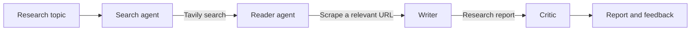

# LangChain Multi-Agent Research System

A research assistant that combines web search, page extraction, and language models to produce a structured report with a separate critique. Use the Streamlit interface to submit a topic and review each stage of the workflow.

## Features

- Searches the web for recent information using Tavily.
- Selects and extracts content from a relevant page.
- Drafts a structured research report and generates critic feedback.
- Displays intermediate results and lets you download the report as Markdown.

## Architecture

The application runs a sequential four-stage pipeline:



- **Search agent:** A LangChain agent powered by Google Gemini that uses Tavily to find relevant pages and snippets.
- **Reader agent:** A Google Gemini-powered LangChain agent that uses the scraping tool to extract readable page content.
- **Writer:** A LangChain prompt chain powered by Groq that turns search results and extracted content into a report.
- **Critic:** A second Groq-powered prompt chain that evaluates the report and provides feedback.
- **Web extraction:** Requests fetches pages; Trafilatura, Readability, Beautiful Soup, and lxml provide content extraction fallbacks.
- **Interface:** Streamlit presents the topic input, pipeline progress, intermediate outputs, report, and download button.

## Technologies

- Python 3.14 or newer
- [LangChain](https://www.langchain.com/) and LangChain integrations
- [Google Gemini](https://ai.google.dev/) via `langchain-google-genai`
- [Groq](https://groq.com/) via `langchain-groq`
- [Tavily](https://tavily.com/) via `langchain-tavily`
- [Streamlit](https://streamlit.io/)
- Requests, Beautiful Soup, Trafilatura, Readability, and lxml
- [uv](https://docs.astral.sh/uv/) for dependency and environment management

## Getting started

### Prerequisites

- Python 3.14 or newer
- [uv](https://docs.astral.sh/uv/getting-started/installation/)
- API keys for Google Gemini, Groq, and Tavily

### Install

Clone the repository and enter its directory:

```bash
git clone https://github.com/Ashutosh070707/langchain-multi-agent-research-system.git
cd langchain-multi-agent-research-system
```

Install the project dependencies from the lock file:

```bash
uv sync
```

Create a `.env` file in the project root and add your API keys:

```dotenv
GEMINI_API_KEY=your_gemini_api_key
GROQ_API_KEY=your_groq_api_key
TAVILY_API_KEY=your_tavily_api_key
```

Keep your `.env` file private; it is excluded from version control.

### Run the web app

```bash
uv run streamlit run app.py
```

Open the local URL printed by Streamlit, enter a research topic, and select **Run Research Pipeline**.

### Run the command-line example

```bash
uv run python main.py
```

The CLI example runs the topic currently set in `main.py` and prints the pipeline stages and results to the terminal.

## Project layout

```text
.
├── app.py                                      # Streamlit interface
├── main.py                                     # CLI example
├── pyproject.toml                              # Project metadata and dependencies
├── requirements.txt                            # Pip-compatible dependency list
└── src/
    └── langchain_multi_agent_research_system/
        ├── agents/agents.py                     # Model clients, agents, writer, and critic
        ├── pipelines/pipelines.py               # Sequential research pipeline
        └── tools/tools.py                       # Tavily search and URL scraping tools
```

## Notes

- Search is currently configured to return up to two results, and the reader agent selects a relevant URL to scrape.
- Research output depends on external APIs and the availability and quality of the pages returned by search. Verify important claims against the cited sources.
- The project requires Python 3.14 or newer, as declared in `pyproject.toml`.

## Contributing

Contributions and bug reports are welcome. For changes, please open an issue to discuss substantial proposals, and include a clear description and any relevant reproduction steps in pull requests.

## License

No license file is currently included. Until a license is added, all rights remain with the copyright holder; please contact the repository owner before redistributing or reusing this project.
